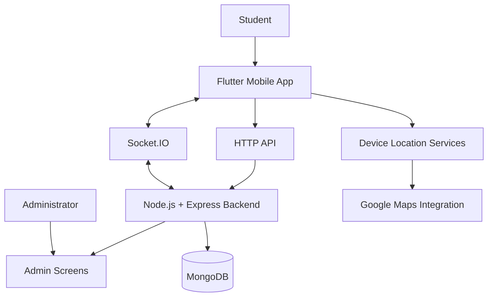

[README_SafeCampus.md](https://github.com/user-attachments/files/33823482/README_SafeCampus.md)
<div align="center">

# SafeCampus

### Student Safety & Emergency Alert System

A Flutter-based campus safety application designed to help students raise emergency alerts and help administrators monitor reported locations.


**Campus Safety · SOS Alerts · Location Tracking · Admin Monitoring**

</div>

---

## 📖 About

**SafeCampus** is a student safety application built with Flutter, with a Node.js backend for location data and real-time communication. The project is designed around two user experiences: a student-facing mobile application and an administrator-facing interface.

The student side includes account screens, emergency-related features, location and audio screens, and campus safety resources. The backend uses Express, MongoDB, and Socket.IO to receive location updates and deliver updates to connected clients.

> **Project status:** Developed as an academic project and subject to ongoing improvements. Configure the backend, database, Google Maps, and device permissions before running it in your environment.

## ✨ Features

<table>
<tr>
<td width="50%" valign="top">

### 🆘 Student Safety
- Student sign-up and login screens
- Student home and profile screens
- Emergency-related location and audio screens
- Emergency contacts
- Incident reporting and feedback screens
- Safety awareness resources and self-defence tips

</td>
<td width="50%" valign="top">

### 📍 Location & Admin Monitoring
- Location capture using device location services
- Google Maps integration
- Backend endpoints for location updates
- Socket.IO communication for real-time updates
- Admin home, location, audio, and profile screens
- MongoDB persistence for location records

</td>
</tr>
<tr>
<td width="50%" valign="top">

### 📚 Campus Support
- Safety resources
- Emergency contact information
- Support group screen
- Chatbot interface
- Settings and profile screens

</td>
<td width="50%" valign="top">

### 🛠️ Technical Design
- Flutter mobile application
- Node.js and Express backend
- MongoDB location storage
- Socket.IO event communication
- Hive local data storage
- SharedPreferences for local preferences

</td>
</tr>
</table>

*Feature availability depends on backend configuration, permissions, and the current implementation. Do not treat this app as a substitute for official emergency services.*

## 🧰 Tech Stack

| Component | Technologies |
|---|---|
| Mobile app | Flutter, Dart |
| Local persistence | Hive, Hive Flutter |
| Local preferences | SharedPreferences |
| Location | Geolocator, Geocoding |
| Maps | Google Maps Flutter |
| Real-time communication | Socket.IO Client |
| Audio | `record`, `flutter_sound`, `audioplayers` |
| HTTP requests | `http` |
| Backend | Node.js, Express.js |
| Database | MongoDB |
| Backend real-time layer | Socket.IO |

## 🏗️ Architecture



### How it works

1. A student uses the Flutter app and grants the required device permissions.
2. The app can obtain location data through the device's location services.
3. The mobile app communicates with the backend through HTTP endpoints and Socket.IO events.
4. The backend stores location records in MongoDB and emits location updates to connected clients.
5. The administrator interface provides screens for reviewing location and audio-related information.

The actual behavior depends on the app state, permissions, network configuration, and backend implementation.

## 🗂️ Project Structure

```text
safecampus/
├── lib/
│   ├── constants/
│   │   └── api_constants.dart
│   ├── models/
│   │   └── student.dart
│   ├── screens/
│   │   ├── homepage.dart
│   │   ├── login_screen.dart
│   │   ├── signuppage.dart
│   │   ├── location_screen.dart
│   │   ├── audio_screen.dart
│   │   ├── admin_homepage.dart
│   │   ├── admin_location_screen.dart
│   │   ├── admin_audio_screen.dart
│   │   └── sidebar/
│   ├── widgets/
│   └── main.dart
├── location-backend/
│   ├── server.js
│   └── package.json
├── assets/
│   └── images/
├── android/
├── ios/
├── pubspec.yaml
└── README.md
```

## 🚀 Getting Started

### Prerequisites

Install the following:

- [Flutter SDK](https://docs.flutter.dev/get-started/install)
- [Dart SDK](https://dart.dev/get-dart) (included with Flutter)
- [Node.js](https://nodejs.org/)
- npm
- A MongoDB database or MongoDB Atlas cluster
- Android Studio or another supported Flutter development environment
- A Google Maps API key with the required Maps SDKs enabled

### 1. Clone the repository

```bash
git clone https://github.com/YOUR_USERNAME/safecampus-student-safety.git
cd safecampus-student-safety
```

Replace `YOUR_USERNAME` with your GitHub username. If you chose a different repository name, use that URL and directory name instead.

### 2. Configure the backend

```bash
cd location-backend
npm install
```

Create a `.env` file in `location-backend/`:

```env
PORT=3000
MONGODB_URI=your_mongodb_connection_string
```

Use your own MongoDB connection string. Do not commit `.env` or any credentials to GitHub.

Start the backend:

```bash
npm start
```

The backend defaults to port `3000`.

### 3. Configure the Flutter app

Open a second terminal from the repository root:

```bash
flutter pub get
```

Configure the backend URL for the device or emulator in `lib/constants/api_constants.dart` or your preferred configuration mechanism.

Typical local development addresses:

- **Android emulator:** `http://10.0.2.2:3000`
- **Physical Android device:** `http://YOUR_COMPUTER_LAN_IP:3000`

For a physical device, both devices generally need to be on the same network, and the computer firewall must allow the backend port.

Configure Google Maps with your own API key. Prefer platform-specific configuration or environment-based injection, and restrict the key to the required apps and APIs.

### 4. Run the app

Connect a device or start an emulator, then run:

```bash
flutter run
```

## 🔌 Backend API

The current backend includes these location endpoints:

| Method | Endpoint | Purpose |
|---|---|---|
| `POST` | `/api/send-location` | Receives and stores location data |
| `GET` | `/api/location-data` | Retrieves stored location records |

The Socket.IO server also handles events including:

| Event | Purpose |
|---|---|
| `register_user` | Registers a connected client's user/admin role |
| `location_update` | Receives a location update from a client |
| `user_location_update` | Delivers location updates to connected admin clients |
| `newLocation` | Broadcasts a newly received location record |

These names reflect the backend source. Review the server and client code for the exact payload format and authentication requirements before deploying it.

## 🔐 Privacy & Security

Because this application handles sensitive location and potentially audio data, responsible configuration is essential.

- Request location and microphone permissions only when needed and explain why they are required.
- Restrict access to student information and administrator functions.
- Add authentication and authorization checks to backend endpoints and Socket.IO events before public deployment.
- Avoid exposing precise location data to unauthorized clients.
- Keep MongoDB credentials and API keys out of source control.
- Restrict Google Maps API keys to the necessary applications and APIs.
- Use HTTPS/WSS and appropriate database access controls in production.
- Define clear retention and deletion rules for location and audio data.
- Test emergency flows carefully; do not rely on an unverified app as the only way to request help.

## 🧪 Testing

Run Flutter's available checks from the repository root:

```bash
flutter analyze
flutter test
```

The backend currently defines a start script. Add automated backend tests for location endpoints, Socket.IO events, and authorization as the project evolves.

## 🔭 Future Improvements

- Harden authentication and role-based authorization.
- Improve reliability of emergency alert delivery.
- Add secure live location sharing with clear user consent.
- Improve error handling and connection recovery.
- Add backend tests and structured logging.
- Document deployment and production environment configuration.

## 👨‍💻 Author

**Althaf Yazin**  
B.Tech Computer Science and Engineering  
MAR ATHANASIUS COLLEGE OF ENGINEERING, Kerala

## 📄 License

No license is specified by default. Add a `LICENSE` file if you intend to allow others to use, modify, or distribute this project.

---

<div align="center">

**SafeCampus** — Supporting a safer campus through technology.

</div>
