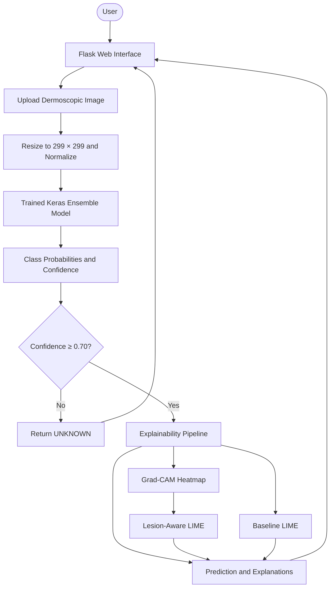

<div align="center">

# DermExplain AI

### Explainable Skin Lesion Classification with Deep Learning

A research-oriented web application that classifies dermoscopic skin-lesion images into seven model-defined categories and visualizes model attention with Explainable AI techniques.


**Skin Lesion Classification · Model Interpretability · Grad-CAM · LIME · SHAP**

</div>

---

## 📌 Overview

**DermExplain AI** is a Python-based web application for experimenting with deep-learning-based skin-lesion image classification and model explainability. A user uploads an image through a Flask interface, and the trained model returns a predicted class, confidence score, and class-wise probabilities. When a prediction passes the configured confidence threshold, the application generates visual explanations to help inspect which image regions influenced the model.

The project includes a baseline LIME explanation and a custom **lesion-aware LIME** workflow that uses a Grad-CAM-derived region of interest, lesion-overlapping superpixels, image perturbations, and a Ridge surrogate model.

> **Important:** This is an academic/research project, not a medical device. Its predictions are not a diagnosis and must not be used to make medical decisions. Consult a qualified healthcare professional for concerns about a skin lesion.

## ✨ Features

<table>
<tr>
<td width="50%" valign="top">

### 🧠 Deep Learning Prediction
- Upload a dermoscopic image through a web interface
- Resize and normalize the image for model inference
- Predict among seven trained classes
- Display confidence and class-wise probabilities
- Return an `UNKNOWN` result below the configured confidence threshold

</td>
<td width="50%" valign="top">

### 🔍 Explainable AI
- **Grad-CAM:** generates a heatmap of influential model regions
- **LIME:** produces a local superpixel-based explanation
- **Lesion-aware LIME:** focuses perturbation analysis on regions overlapping the Grad-CAM-derived lesion ROI
- **SHAP:** includes a GradientExplainer workflow for offline analysis
- Text summary of influential lesion-region patches

</td>
</tr>
</table>

## 🧪 Model Classes

The application uses the following class labels in its prediction code:

| Label | Display name used by the application |
|---|---|
| `AKIEC` | Actinic Keratosis |
| `BCC` | Basal Cell Carcinoma |
| `BKL` | Benign Keratosis |
| `DF` | Dermatofibroma |
| `MEL` | Melanoma |
| `NV` | Melanocytic Nevi |
| `VASC` | Vascular Lesions |
| `UNKNOWN` | Unknown / below confidence threshold |

The model has seven trained output classes. `UNKNOWN` is a rejection state when the maximum predicted confidence is below the configured threshold; it is not an eighth trained class.

## 🧰 Tech Stack

| Area | Technologies |
|---|---|
| Language | Python |
| Web framework | Flask |
| Deep learning | TensorFlow, Keras |
| Image processing | Pillow, OpenCV, NumPy |
| Explainability | Grad-CAM, LIME, SHAP |
| Superpixels and segmentation | scikit-image |
| Surrogate model | scikit-learn Ridge regression |
| UI | HTML, CSS, Jinja templates |

## 🏗️ How It Works



### Explainability pipeline

1. **Preprocessing:** the uploaded image is converted to RGB, resized to `299 × 299`, normalized to the `[0, 1]` range, and expanded to a batch.
2. **Classification:** the saved Keras model receives the same image tensor through its two input branches.
3. **Confidence handling:** the highest-probability class is selected. If its confidence is below `0.70`, the prediction is returned as `UNKNOWN` and the explainability steps are skipped.
4. **Grad-CAM:** gradients from the predicted class are used to create a heatmap for the configured convolutional layer.
5. **Baseline LIME:** a local image explanation is generated using superpixel perturbations.
6. **Lesion-aware LIME:** the Grad-CAM heatmap is thresholded to create a region-of-interest mask. Overlapping superpixels are perturbed, a weighted Ridge surrogate is fitted, and influential regions are visualized.
7. **Results:** the web page displays the predicted class, confidence, class probabilities, and available explanation visuals.

The SHAP implementation is available as a separate offline workflow and may require substantial compute resources.

## 🗂️ Project Structure

```text
skinlesion/
├── app.py                         # Basic Flask prediction interface
├── templates/
│   └── index.html                 # Basic upload and prediction page
├── backend/
│   ├── app.py                     # Prediction + explainability web app
│   ├── model_loader.py             # Loads the trained Keras model
│   ├── predict.py                  # Class mapping and confidence threshold
│   ├── preprocess.py               # Image preprocessing
│   ├── requirements.txt            # Python dependencies
│   ├── run_shap_offline.py         # Offline SHAP runner
│   ├── shap_task.py                # Background SHAP helper
│   ├── explainability/
│   │   ├── gradcam.py
│   │   ├── lime_explainer.py
│   │   ├── shap_explainer.py
│   │   └── lime_lesion_aware/
│   │       ├── explainer.py
│   │       ├── patch_generator.py
│   │       ├── perturbation.py
│   │       ├── roi_mask.py
│   │       ├── surrogate.py
│   │       ├── text_explainer.py
│   │       └── visualize.py
│   └── templates/
│       └── index.html              # Explainability results page
└── README.md
```

## 🚀 Getting Started

### Prerequisites

- Python 3.10 or another Python version supported by your installed TensorFlow release
- `pip`
- A trained Keras model compatible with the application
- Sufficient memory and compute for model inference and explainability calculations

### 1. Clone the repository

```bash
git clone https://github.com/YOUR_USERNAME/derm-explain-ai.git
cd derm-explain-ai
```

Replace `YOUR_USERNAME` with your GitHub username, and use your actual repository URL if you choose a different name.

### 2. Create and activate a virtual environment

**Windows**

```bash
python -m venv .venv
.venv\Scripts\activate
```

**macOS / Linux**

```bash
python3 -m venv .venv
source .venv/bin/activate
```

### 3. Install dependencies

```bash
pip install -r backend/requirements.txt
```

TensorFlow and SHAP versions can be sensitive to Python and dependency versions. If installation fails, use a compatible Python/TensorFlow environment and pin tested package versions.

### 4. Add the trained model

The backend model loader expects the model at:

```text
backend/model/incepx_ensemble_best.keras
```

The model file is excluded from version control by the repository's `.gitignore`. Obtain the trained model from its owner/training workflow and place it at the expected path. Do not assume the application will run without it.

The root-level `app.py` uses a different legacy model path:

```text
model/incepx_ensemble_best.h5
```

For the explainability workflow, use the backend application described below.

### 5. Run the explainability application

From the repository root:

```bash
python backend/app.py
```

Open the local URL shown in the Flask console, typically:

```text
http://127.0.0.1:5000
```

The backend loads the model during application startup. If the model file is missing or incompatible, startup will fail.

### 6. Run the basic prediction interface (optional)

The repository also includes a simpler root-level Flask app:

```bash
python app.py
```

This app expects the legacy `.h5` model at `model/incepx_ensemble_best.h5`. Use the model file and path expected by that script.

## 🔬 Run SHAP Analysis Offline

The repository contains a separate script for SHAP visualization. First run the backend app and upload an image so the latest image is saved, then stop or leave the web app running as appropriate for your environment. In a separate terminal, from the repository root:

```bash
python backend/run_shap_offline.py
```

The script looks for:

```text
backend/static/last_uploaded.jpg
```

It writes the SHAP visualization to `backend/static/shap.png`. SHAP analysis may take time and may need additional memory.

## ⚙️ Configuration

The following settings are defined in the source code and may need adjustment for another trained model:

- **Input image size:** `299 × 299`
- **Confidence threshold:** `0.70`
- **Class order:** `AKIEC`, `BCC`, `BKL`, `DF`, `MEL`, `NV`, `VASC`
- **Grad-CAM convolutional layer:** `block14_sepconv2_act`
- **Model file:** `backend/model/incepx_ensemble_best.keras`

The class order and model architecture must match the model used for training. Changing them without validating the model can produce incorrect labels or failed explanations.

## 🔐 Privacy and Responsible Use

- Use only images you have permission to process.
- Avoid uploading identifiable or sensitive medical images to public services.
- Do not expose a public instance without appropriate upload validation, size limits, access controls, and secure deployment settings.
- Treat confidence scores as model outputs, not calibrated medical certainty.
- Heatmaps and LIME/SHAP visuals explain aspects of model behavior; they do not prove a prediction is clinically correct.
- Have any clinical application independently evaluated by qualified medical professionals and validated on appropriate datasets before considering real-world use.

## 🛣️ Potential Improvements

- Add automated tests for preprocessing, class mapping, and prediction handling.
- Pin and document verified dependency versions.
- Improve upload validation and error handling.
- Add model evaluation metrics and dataset documentation.
- Validate the confidence threshold and calibration on a held-out dataset.
- Add performance controls for expensive explanation methods.
- Improve reproducibility of the lesion-aware LIME perturbation workflow.

## 👨‍💻 Author

**Althaf Yazin**  
B.Tech Computer Science and Engineering  
MAR ATHANASIUS COLLEGE OF ENGINEERING, Kerala

## 📄 License

No license is specified by default. Add a `LICENSE` file if you intend to permit others to use, modify, or distribute this project.

---

<div align="center">

**DermExplain AI** · Exploring interpretable deep learning for skin-lesion image classification.

</div>
